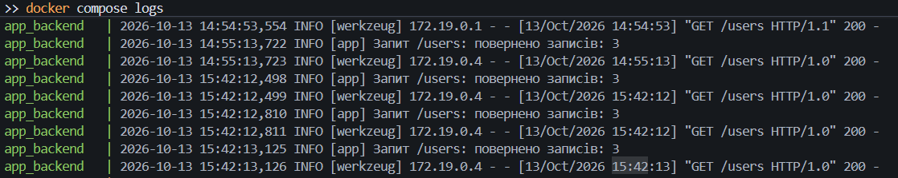

# Мережа з кількох контейнерів: Frontend + Backend + Database

---

## Опис

Три контейнери, з'єднані спільною мережею `app_network`:

- `app_frontend` — Nginx зі сторінкою (HTML/CSS/JS), порт `8080`; запити `/api/...` передає до backend;
- `app_backend` — REST API на Python (Flask): `GET /users`, `GET /health`, порт `5000`;
- `app_db` — база даних PostgreSQL, порт `5433`, дані зберігаються в volume `db_data`.

Сторінка запитує `/api/users` → `app_frontend` → `app_backend` → `app_db`. Конфігурації винесено у файл `.env`, для всіх контейнерів налаштовано `healthcheck` та логування.

## Структура проєкту

```text
.
├── docker-compose.yml
├── .env                    # конфігурації (порти, БД, логування)
├── README.md
├── screenshots/            # скріншоти
├── db/
│   └── init.sql
├── backend/
│   ├── Dockerfile
│   ├── app.py
│   ├── requirements.txt
│   └── .dockerignore
└── frontend/
    ├── Dockerfile
    ├── nginx.conf
    └── html/
        ├── index.html
        ├── style.css
        └── script.js
```

---

## Кроки виконання

### 1. Запуск

```bash
docker compose up -d --build
```

### 2. Стан контейнерів

```bash
docker compose ps
```


_Скріншот 1. Три контейнери у стані `Up`, статус `healthy`, видно мапінг портів._

### 3. Frontend

Відкрив <http://localhost:8080>.


_Скріншот 2. Браузер з адресою `http://localhost:8080` і таблицею користувачів._

### 4. REST API

```bash
curl.exe http://localhost:5000/users
curl.exe http://localhost:8080/api/users
```


_Скріншот 3. Обидві команди повертають однаковий JSON._

### 5. Збереження даних (volume)

```bash
docker volume ls
docker compose down
docker compose up -d
curl.exe http://localhost:8080/api/users
```


_Скріншот 4. Є volume `..._db_data`, після перезапуску дані на місці._

### 6. Мережа

```bash
docker network ls
docker network inspect <назва_папки_проєкту>_app_network
```


_Скріншот 5. `"Driver": "bridge"` та три контейнери в розділі `Containers`._

### 7. Healthcheck

```bash
docker inspect --format "{{json .State.Health}}" app_backend
```


_Скріншот 6. `"Status":"healthy"`._

### 8. Логи всіх контейнерів

Спочатку відкрив сторінку й натиснув «Оновити» кілька разів, потім:

```bash
docker compose logs
```



_Скріншот 7. Записи від усіх трьох контейнерів._

### 9. Логи окремого контейнера

```bash
docker logs -t --tail 20 app_backend
```


_Скріншот 8. Рядки про запуск backend та запити `/users`._

### 10. Логування помилки

```bash
docker compose stop db
curl.exe http://localhost:8080/api/users
docker logs --tail 5 app_backend
docker compose start db
```


_Скріншот 9. Відповідь `curl.exe` з помилкою (код `500`) та рядок `ERROR` у логах._

### 11. Зупинка

```bash
docker compose down        # дані залишаються
docker compose down -v     # разом із видаленням volume
```
